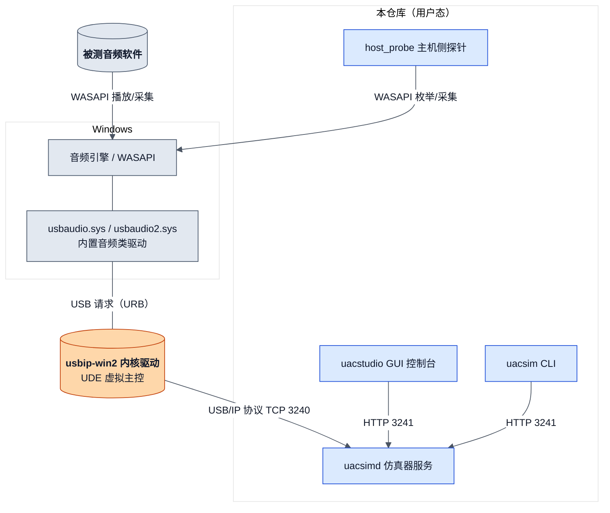
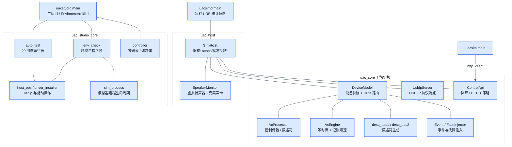
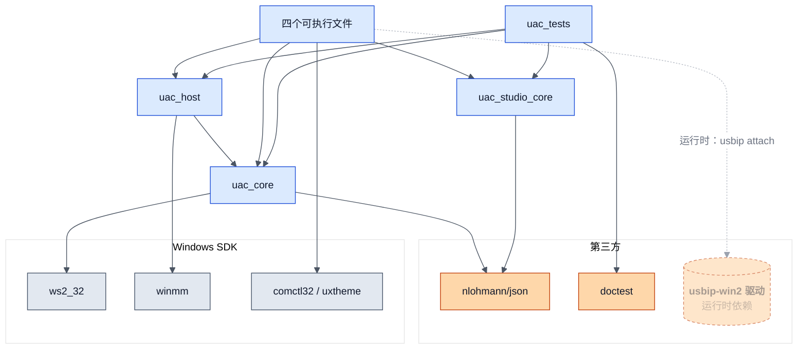
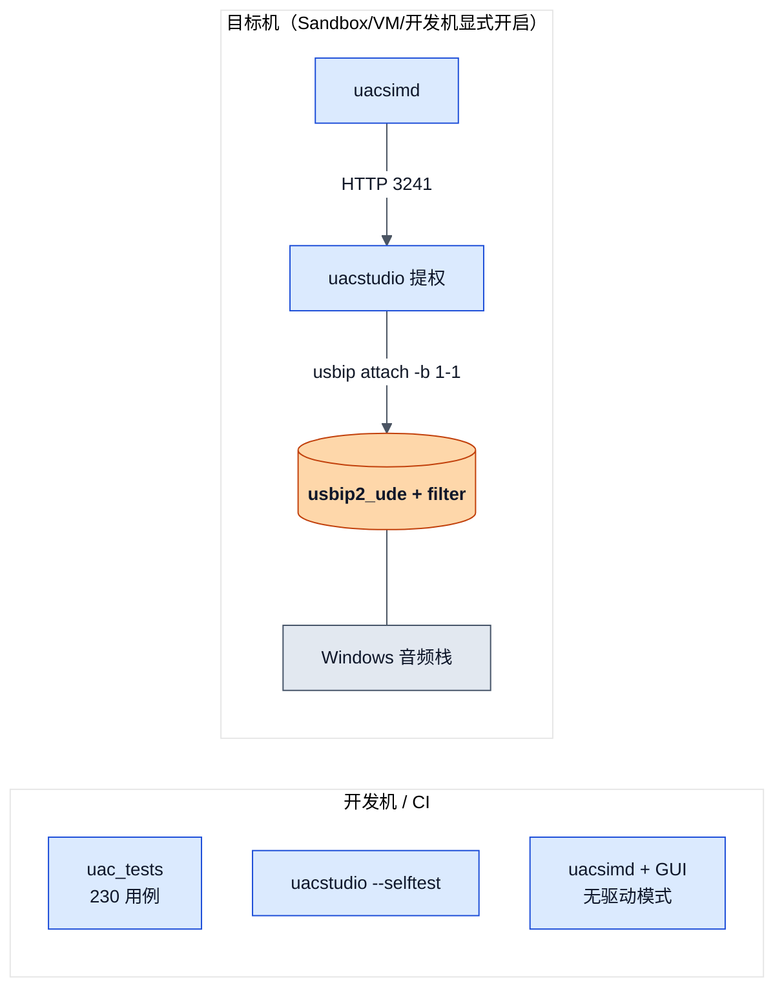
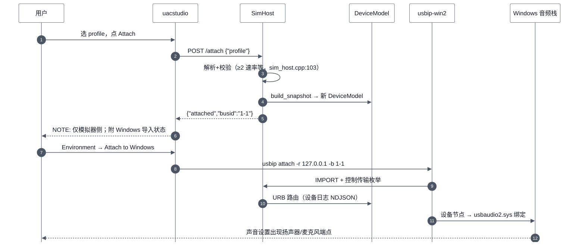
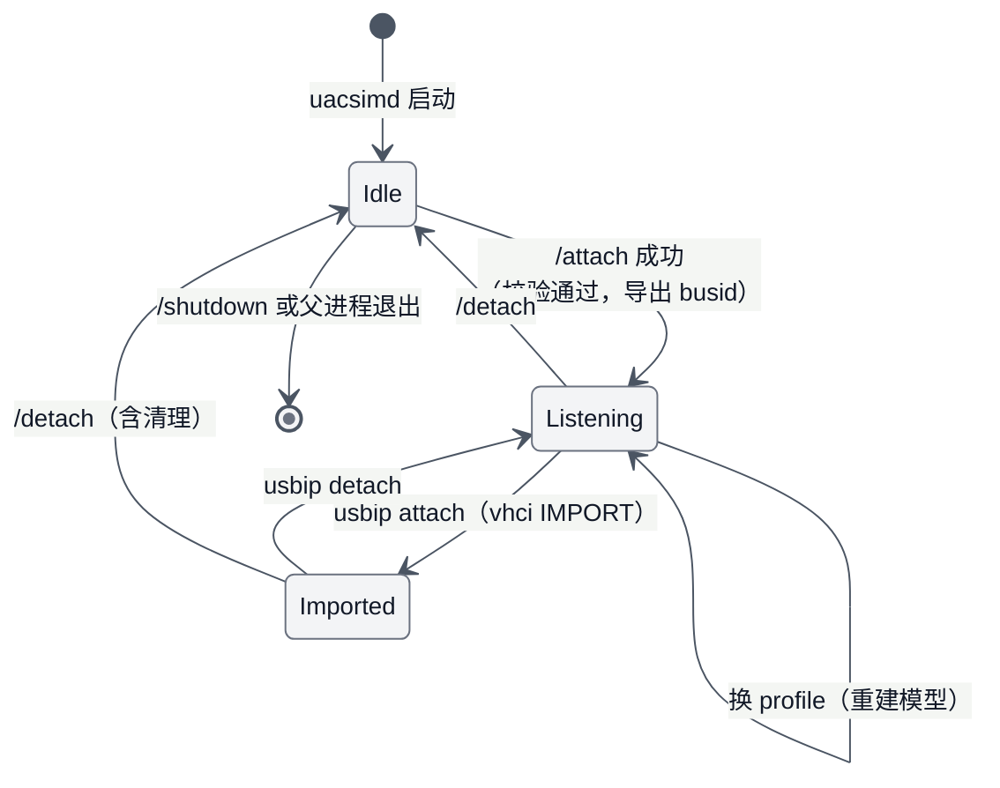

# phantom-audio 架构设计

> 类型：arch ｜ 模式：Reverse ｜ 代码基线：`936376c` ｜ 最后核对：2026-11-01 ｜ 范围：`tools/uac-simulator/` ｜ lang: zh

## Overview

phantom-audio 是 Windows 纯软件虚拟 USB 音频设备（UAC1/UAC2）测试台：**4 个用户态进程 + 1 个第三方内核驱动**组成，被测软件经 WASAPI 看到"真 USB 声卡"（Windows 内置类驱动绑定）。全部设备模型在用户态；内核侧复用开源 usbip-win2（UDE 框架），零内核开发。

图例：蓝色 = 本仓库用户态；橙色 = 第三方内核（usbip-win2）；灰色 = Windows 系统组件；白底描边药丸 = 判定。

**TL;DR**

- 控制面（HTTP 127.0.0.1:3241）与数据面（USB/IP TCP 3240）分离，三个客户端共享同一 API
- 设备模型全部用户态：Profile → DeviceSnapshot → DeviceModel（AcProcessor + AsEngine）
- 已知边界：usbip-win2/UDE 等时数据载荷在本机（Win11 26200）双向不通，详见 Risks
- 单测 230 例 + GUI 非视觉自检 3 阶段 + 一键 autotest 20 用例三道防线

## Architecture Context

被测软件与音频栈是 Windows 系统组件；唯一的外部内核依赖是 usbip-win2（BSD-2-Clause，已签名）。

## Logical Architecture

三个静态库按"能否单测"分层：`uac_core` 无窗口依赖，`uac_host` 编排层，`uac_studio_core` 含非窗口 GUI 逻辑（`CMakeLists.txt:56-74`）。

## Component Responsibilities

| Component | Owns | Does not own |
|---|---|---|
| SimHost | profile 解析与校验、多实例、监听/导入状态、扬声器监听接线 | USB/IP 协议编解码、描述符内容 |
| DeviceModel | 设备快照持有、URB 按端点路由、诊断计数 | 速率控制算法、控制请求语义 |
| AcProcessor | 控制 transfer 语义（时钟/FU/描述符/字符串）、NDJSON 日志 | 等时数据 |
| AsEngine | 等时 IN 打包（内容记账限速）、OUT 解码、监听回调 | USB/IP 帧格式 |
| UsbIpServer | TCP 通道、CMD/RET 编解码、完成回调封装 | 设备语义 |
| ControlApi | 端点分发、回环/Origin/体积/时限安全策略 | 业务语义 |
| SpeakerMonitor | winmm 双缓冲播放到真实输出设备 | 音频处理（直通 16 位 PCM） |
| auto_test | 20 用例表 + 运行器 + 报告文件 | 单个用例的实现 |
| host_ops | Attach/Detach to Windows、驱动装卸编排 | 守卫判定（调 HostCasesAllowed） |
| env_check | 7 项环境检测 + 动作按钮窗口 | 驱动安装本身 |
| sim_process | 起/停 uacsimd、--parent-pid 兜底、只动自己启动的 | HTTP 通信 |

## Dependency Architecture

内核驱动仅在宿主侧操作（attach/驱动装卸）时需要；仿真与全部单测无需驱动。

## Runtime / Deployment Architecture

同一套产物两种部署：开发机跑 ①②层验证（无驱动），zip（`build.bat` 产 `dist/uacsim-sandbox-*.zip`）拷进 Sandbox 跑 ③层；开发机经 `UACSIM_FORCE_HOST_TESTS=1` 显式开启后同样可跑（CLAUDE.md 硬规则 1）。

## Key Data Flow / Sequence

挂载链路（用户点 Attach 到设备出现在 Windows）：

①-⑤ 为软件侧挂载（任何机器可用）；⑥-⑩ 需要驱动与守卫通过。步骤 ⑨ 之后：控制传输工作正常；等时数据载荷受已知平台缺陷影响（见 Risks）。

## Interface / Contract

控制 API（回环 HTTP，`control_api.cpp:240-266` 分发；策略：拒绝 Origin、Host 须回环、体 ≤1 MiB、总时限）：

| 接口 | 方向 | 载荷 | 语义 |
|---|---|---|---|
| `GET /status` | 客户端→仿真器 | — | 运行/profile/实例/导入/音量/字节计数 |
| `POST /attach` | 同上 | `{"profile"}` | 挂载（校验 ≥2 不同速率） |
| `POST /detach` | 同上 | — | 全部卸载 |
| `POST /event` | 同上 | `{"type":"volume_up"...}` | 设备侧按键事件 |
| `POST /inject` | 同上 | `{"kind":"stall"/"delay_ms"/"disconnect"/"clear"}` | 故障注入 |
| `POST /source` | 同上 | `{"kind":"sine","hz"}` / silence / file | 麦克风源 |
| `POST /capture` | 同上 | `{"path":".wav"}` | 扬声器侧录音落盘 |
| `POST /monitor` | 同上 | `{"on":bool}` | 虚拟扬声器→真实声卡播放开关 |
| `GET /log?n=` / `POST /shutdown` | 同上 | — | NDJSON 尾巴 / 优雅停止 |

完整字段与错误码见 `docs/detailed-design.md` 的 ControlApi 节。

## State / Lifecycle

导入态（Imported）由 `server_.attached()` 报告；多实例（≤4）共享一条总线，每实例独立 busid/devnum（`sim_host.cpp` 导出清单重建）。

## Non-Functional Requirements

| 类别 | 要求 |
|---|---|
| 安全 | 回环 HTTP：无认证但拒绝浏览器跨域（Origin/Host/白名单/体积/时限六道策略） |
| 延迟 | UI 线程任何探测 ≤400 ms（smoke 第二阶段强制） |
| 并发 | ≤4 设备实例（vhci 端口数）；控制 API 并发请求安全 |
| 兼容 | Windows 10/11；Sandbox 无 CJK 字体 → 界面文字全 ASCII |
| 可靠性 | 模拟器 `--parent-pid` 兜底退出；GUI 只停自己启动的进程 |
| 资源 | iso 日志环形 20000 行封顶；监听队列 ≤1 s 丢弃 |

## Key Decisions

| ID | 决策 | 状态 | 备选 | 原因 | 影响 |
|---|---|---|---|---|---|
| ADR-001 | 复用 usbip-win2（UDE）而非自研内核驱动 | Accepted | 自研 UDE 驱动；WDM vhci | 零内核开发、已签名 | 等时数据受上游缺陷制约（见 R-001） |
| ADR-002 | 控制面 HTTP / 数据面 USB/IP 分离 | Accepted | 单通道 | 三客户端共享；CI 可驱动 | 两套端口（3241/3240） |
| ADR-003 | UAC2 profile 强制 ≥2 不同采样率 | Accepted | 允许单速率 | usbaudio2 单速率不启动音频功能（真机实证） | profile 设计约束 |
| ADR-004 | iso IN 立即完成 + 墙钟内容记账限速 | Accepted | 延迟完成 | 客户端对延迟 RET 弃管（真机实证） | 暖机首包为合法零长帧 |
| ADR-005 | 设备模型全用户态 | Accepted | 内核态模型 | 可测性（230 单测直驱设备模型） | URB 往返多一层 TCP |
| ADR-006 | 界面文字全 ASCII | Accepted | 本地化 | Sandbox 无 CJK 字体 | `test_env_check` 扫描强制 |
| ADR-007 | 驱动装卸节奏"卸载→重启→安装" | Accepted | 热装卸 | 热装卸楔死内核栈（两次实证，runbook） | 换版本成本高 |

## Risks / Open Issues

| ID | 问题/风险 | 影响 | 状态 | 责任 |
|---|---|---|---|---|
| R-001 | usbip-win2/UDE 等时数据载荷双向不通（本机 Win11 26200；0.9.8.0/0.9.8.1、UAC1/UAC2 均复现） | 高：麦克风流无声、混音器不跟设备音量 | Open · 证据链见 runbook "iso IN" | 上游 usbip-win2 |
| R-002 | R-001 的出路三选一：上游修复 / WDM vhci 对照（料已备） / 自研 UDE（uacvirt） | 中：决定 ADR-001 是否维持 | Open | 维护者 |
| R-003 | WDM vhci 为测试签名，启用需 testsigning（水印+内核安全面） | 低：仅实验路径 | Open | 维护者 |

## 待确认项

- 覆盖率门禁当前值（M4 时为 95%；今日改动后未重测，`coverage.ps1` 可复测）
- `docs/superpowers/` 历史 spec 与本文档的对应关系未逐条核对（按 CLAUDE.md 约定以本文档为准）
