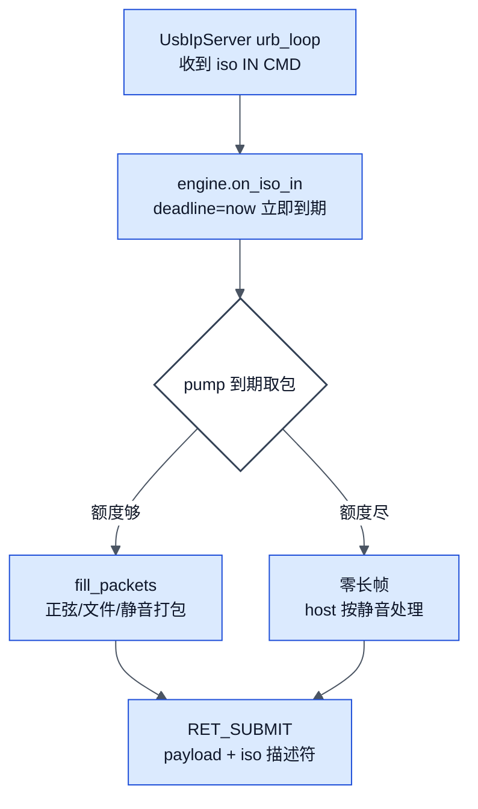

# phantom-audio 详细设计

> 类型：arch ｜ 模式：Reverse ｜ 代码基线：`936376c` ｜ 最后核对：2026-11-01 ｜ 范围：`tools/uac-simulator/src include/uac apps/` ｜ lang: zh

## Overview

本文档承接 `architecture.md`（L0/L1），落到**模块内部机制**（L2）：每节一个模块，含规则表与关键锚点。验证分层与操作细节见 `runbook.md` / `userguide.md`。

图例：蓝色 = 本仓库代码；灰色 = 外部组件；白底描边药丸 = 判定。

## DeviceModel：URB 路由

`on_urb` 按端点地址分发（`src/device_model.cpp:257-331`）：

| 端点 | 方向/类型 | 处理 | 锚点 |
|---|---|---|---|
| ep0 | 控制 | `AcProcessor::on_control`；完成按数据阶段回 `actual_length` | device_model.cpp:222 |
| 0x81 | 中断 IN | Status Word：有通知立即回，否则挂起（held） | device_model.cpp:300 |
| 0x82 | 中断 IN | HID 按键报告队列；空则挂起 | device_model.cpp:280 |
| 0x84 | 等时 IN | 反馈值 Q16.16（rate×2^16/8000）立即回 | device_model.cpp:263 |
| 0x86 | 等时 IN | 交 `AsEngine`（见下节） | device_model.cpp:272 |
| 0x06 | 等时 OUT | 立即确认 + 数据交引擎（capture/监听） | device_model.cpp:312 |
| 其它 | — | STALL（-EPIPE） | device_model.cpp:327 |

**控制写完成必须上报数据阶段长度**：SET_CUR 类 4 字节写曾恒报 `actual_length=0`，usbaudio2 视为未写入无限重发（真机 ~400 次/秒风暴；修复见 `device_model.cpp:222`）。

诊断计数（每端点原子计数 + 每秒一行 `{"event":"urb_stats"}`，空闲秒静默）：`ep0/ok/stall/int81/hid82/fb84/iso86/iso06/unk/unl + heldInt/heldHid`（`device_model.h` 成员区、`sim_host.cpp dump_urb_stats`）。

## AcProcessor：控制传输语义

分发顺序（`src/ac_processor.cpp`）：标准/设备 → 标准/接口 → 标准/端点 → 类/接口（UAC2 分支 → UAC1 分支）→ 未知 STALL。关键规则：

| 规则 | 语义 | 锚点 |
|---|---|---|
| 时钟 SET_CUR 范围校验 | 宣告范围外一律 STALL（Windows"默认格式"组件会把时钟设成 44100 造成短包） | ac_processor.cpp:167 |
| 时钟 RANGE | `numSubRanges + {MIN,MAX,RES}×n`，离散档 MIN=MAX、RES=1 | ac_processor.cpp:178 |
| FU 音量/静音 | SET 同步双声道；GET 返回当前态 | ac_processor.cpp:185 |
| 描述符 | Device/Config/String(含 LANGID)/BOS/Qualifier 全应答；lint 校验长度表 | ac_processor.cpp:76-105 |
| 日志 | 每条控制一行 NDJSON，OUT 附载荷十六进制（`"data":"80bb0000"`） | ac_processor.cpp:49 |

**UAC2 采样率矩阵**（Win11 26200 真机实证，全表见 runbook）：单速率 → 音频功能 code 10；`{48000,44100}` 可用；三档曾触发交替风暴（根因是上表 actual_length，已修）。

## AsEngine：等时流与内容记账

iso IN 的速率控制 = **立即完成 + 墙钟记账**（`src/as_engine.cpp:98-153`）：

- RET 延迟 ≥1 ms 即被 usbip-win2 客户端弃管（真机实证）→ 完成永不延迟
- 允许帧数 = `(now−流起点)×rate + 2 ms 预支`；额度外发**零长帧**（真设备"本帧无数据"合法形态）
- 空闲 >1 s 重开流（不补偿离线时段）
- `ret.start_frame` = **开机毫秒**（`GetTickCount64`，与 ude_filter 的 QueryBusTime 同纪元；异纪元会使 usbaudio2 流位置差=整机运行时长，issue #200）

iso OUT（`as_engine.cpp:185-218`）：按 iso 描述符逐包解码为 16 位 PCM → 录音 WAV 落盘（`/capture`）+ 监听回调（同份 PCM）。

## UsbIpServer：协议与通道

- `urb_loop`（`usbip_server.cpp:250`）逐条收 CMD_SUBMIT/UNLINK；**每条日志行 = 一条真实网络命令**（无重放路径）
- RET_SUBMIT 字节序：header → **payload → iso 描述符**（客户端 MDL 链序，wsk_receive_irp.cpp 实证）
- 控制连接 250 ms 收超时 + 空闲时限（三态 recv 防慢速对端断流）；IMPORT 移交通道线程时清零 SO_RCVTIMEO
- 诊断倾倒：前 12 条 iso CMD 形状 + 前 10 条 mic CMD + 前 2 条 iso IN RET 线上字节 → `uac-ret-diag.txt`（封顶，定位协议问题用）

## SimHost：挂载管线与监听

`on_attach`（`apps/uacsimd/sim_host.cpp:103`）管线：

1. profile 名白名单（`policy::valid_profile_name`，HTTP 侧；CLI 保留完整路径语义）
2. 解析：exe 旁 `profiles/`（CMake POST_BUILD 部署）→ 内置表 `builtinProfiles()`（单一真源）
3. UAC2 校验 ≥2 不同速率 → 否则拒绝并说明原因
4. `server_.stop()` 重建导出清单（每实例独立 busid "1-N"）
5. `apply_monitor()` 接线扬声器监听

监听链（`speaker_monitor.cpp`）：引擎回调 → 队列（≤1 s，满则丢）→ winmm 4×100 ms 双缓冲；设备选择 = 首个名字不含**本设备 iProduct**（`DeviceModel::product()`，防回灌成回声环）的输出设备；`/monitor` 开关默认开。

## ControlApi：端点与安全策略

端点清单见 `architecture.md` Interface 节；策略六道（`src/control_api.cpp` + `path_policy.cpp`）：拒绝 `Origin` 头、`Host` 必须回环、profile 名 `[A-Za-z0-9_-]`、媒体路径必须 `.wav` 且拒绝 UNC/`..`、体 ≤1 MiB、整请求总时限。`POST /shutdown` 仅记录请求，主循环轮询后停服务（避免请求线程内死锁）。

## uacstudio 模块

| 模块 | 机制 | 锚点 |
|---|---|---|
| 主窗口请求队列 | 点击只入队；RequestMain 后台线程发 HTTP，一行一条回日志（时间戳+20 列对齐） | main.cpp:564 |
| Attach 真话提示 | 请求后查 `usbip port`，按"已在 Windows/仅模拟器/VHCI 缺失"三态追加说明 | main.cpp:564 起 |
| 守卫链 | `HostCasesAllowed`：`--allow-host`/env → 提权（IsProcessAdmin）→ 一次性机器/强制开关 | auto_test.cpp:350 |
| Restart as administrator | 守卫拒绝时显示；后台 ShellExecute runas 自身 + `--allow-host`，自己启动的模拟器先停后随新实例重启 | env_check.cpp id 3 |
| Environment 检测 7 项 | uacsimd 可达 / 守卫 / 驱动服务 / **VHCI 根设备探测**（`usbip port`，缺失给修复三步）/ usbip.exe / Hyper-V / 汇总 | env_check.cpp:145-227 |
| 自动测试 | 20 用例：env×3 + api×11 + host×5 + cleanup；host.* 全走 SKIP 守卫；报告落桌面 | auto_test.cpp Cases() |
| 深色主题 | 按钮全 OWNERDRAW；EDIT 边框 WM_NCPAINT 深色环；滚动条 DarkMode_Explorer；组合框 OWNERDRAW+**CBS_HASSTRINGS**（漏它曾致 profile 乱码） | main.cpp:90-150 |
| 进程生命周期 | `--parent-pid` 兜底；只停自己启动的模拟器；smoke 三阶段验证 A/B/C | sim_process.cpp |

## 诊断格式速查

| 行 | 产生者 | 用途 |
|---|---|---|
| `{"ts":…,"bmRequestType":…,"data":"hex","resp":"ok"}` | AcProcessor | 每条控制传输（含 OUT 载荷） |
| `{"event":"urb_stats","ep0":n,…}` | uacsimd 每秒 | 全端点增量，看风暴在哪个端点 |
| `{"event":"inject_volume/hid/mute",…}` | 事件注入 | 设备侧事件回执 |
| `CMD iso: ep=… nPackets=…` | UsbIpServer（封顶倾倒） | 主机请求形状 |
| `RET hex: hdr=… payload=… iso=…` | 同上 | 我们回应的线上字节 |

## Key Decisions（模块级）

| ID | 决策 | 状态 | 原因 |
|---|---|---|---|
| DDR-001 | 监听设备按 iProduct 排除自身 | Accepted | 防回灌回声环 |
| DDR-002 | 日志面板不灌设备 NDJSON | Accepted | 一行一条可读；原始流水走文件 |
| DDR-003 | LED 显示设备侧音量 | Accepted | Windows 混音器不跟 Status Word 时保可见反馈 |
| DDR-004 | 诊断倾倒封顶（12+10+2 条） | Accepted | 长跑不膨胀 |

## Risks / Open Issues

| ID | 问题 | 影响 | 状态 |
|---|---|---|---|
| DDR-R-001 | 内容记账的 2 ms 预支在慢主机上可能欠供（未观测到） | 低 | Open |
| DDR-R-002 | `uac-ret-diag.txt` 写在 CWD，多实例并行会互相追加 | 低 | Open |

## 待确认项

- `desc_hid.cpp` 的报告描述符与真机 dump 的逐字节一致性（单测覆盖生成器，未对真机）
