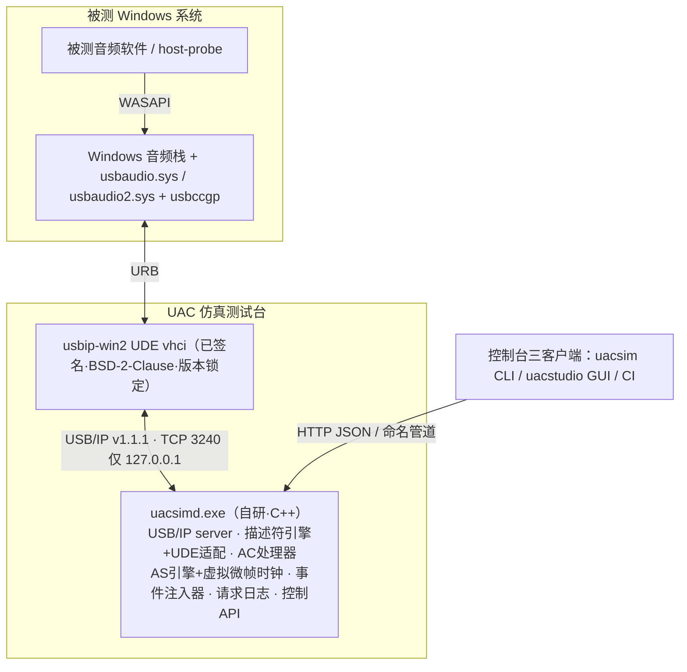

# 设计文档：Windows 虚拟 UAC 设备仿真测试台（修订版）

> 日期：2026-10-29 ｜ 关联 RFC：`rfc-windows-virtual-uac-device.md`（v2，同日修订） ｜ 状态：已批准待落盘评审
>
> **勘误（2026-10-30）**：本文早先写作“usbip-win2 为 GPLv3”，有误：其许可为 BSD-2-Clause（GitHub 仓库登记；`v.0.9.7.8` / `v.0.9.8.1` 标签上的 `LICENSE.txt` 均为 BSD 2-Clause）。已更正下文三处（决策表“许可边界”、架构图节点、R-002），不改变架构结论。详见 RFC 顶部勘误。

## 1. 网络核实结论（评估依据）

本节为 RFC 评审的实证基础，全部结论带来源。

### 1.1 RFC 事实性错误（已在 RFC v2 修正）

| # | RFC v1 原文 | 核实结果 | 来源 |
|---|---|---|---|
| E1 | "USBAC2.sys" | 驱动名为 **usbaudio2.sys**（Thesycon 开发、MS 支持，WaveRT miniport，Win10 1703+ 内置；UAC1 为 usbaudio.sys/wdma_usb.inf） | [MS: USB Audio 2.0 Drivers](https://learn.microsoft.com/en-us/windows-hardware/drivers/audio/usb-2-0-audio-drivers) |
| E2 | "商业 USBAnywhere v3.0（WHQL 认证 UDE 方案）" | **查无此产品**，疑似虚构引用。真实商业品：VirtualHere、USB Network Gate、HHD Free Virtual USB Tools、Digi AnywhereUSB——均为网络 USB 重定向，无可编程设备侧模型 | 多引擎搜索无匹配 |
| E3 | "f_uac2 无 AC 中断端点，R6 必须自研" | **过时**：内核 ≥5.16 起 f_uac2（及新版 f_uac1）实现 AC 中断端点 `int_ep` 与 Volume/Mute 通知；Linux VM 降级档**可保留 R6** | [f_uac2.c (torvalds/linux)](https://github.com/torvalds/linux/blob/master/drivers/usb/gadget/function/f_uac2.c)、[f_uac1.c codebrowser](https://codebrowser.dev/linux/linux/drivers/usb/gadget/function/f_uac1.c.html) |
| E4 | "UDE 文档未覆盖 iso，官方口径待确认" | 属实：2022-01 的 [MS Q&A 帖](https://learn.microsoft.com/en-gb/answers/questions/689656/ude-isochronous-endpoints)至今无人回答；但社区已有完整实践解法（见 1.2） | MS Q&A |

### 1.2 R-001（等时链路）真实状态：Medium，解法已知

[usbip-win2 issue #35](https://github.com/vadimgrn/usbip-win2/issues/35)（nefarius/vadimgrn，2023-03 → **2024-04-28 修复关闭**）确立 UDE 虚拟 USB 音频设备"三位一体"解法：

1. 设备呈现 **High-Speed**（`UdecxUsbDeviceInitSetSpeed`；bcdUSB 可保留 0x110）
2. 虚拟主控实现 **QueryBusTime** 返回 `STATUS_SUCCESS`（usbip-win2 已实现）
3. ISOCH 端点 **bInterval ≥ 4**（UDE/USBHUB3 按 125µs 微帧解释；HS 下 bInterval=4 等价 1ms 轮询）

项目状态：活跃维护（2026-10 仍有等时相关 issue [#200](https://github.com/vadimgrn/usbip-win2/issues/200) QueryBusTime 纪元、[#173](https://github.com/vadimgrn/usbip-win2/issues/173) WSK 低延迟）；2026 年初修复 FS 设备枚举（#151/#152）；最新 v0.9.7.8，x64 驱动 **WHLK 认证/attestation 签名**（Open Source Codesigning Initiative），无需测试模式。USB/IP 协议 v1.1.1，兼容 Linux 服务端内核 4.19–7.0。

### 1.3 R6（音量键事件）可行性：UAC2 官方背书

usbaudio2.sys 官方文档明确支持 **INTERRUPT 数据消息（ADC-2 6.1）**：Feature Unit **Volume、Mute**、Terminal **Connector Control**——设备侧 Status Word 中断 → 类驱动补查 → 应用回调链路成立。**usbaudio.sys（UAC1）无此背书**（文档只字未提中断端点），列为 M2 实测项，HID Consumer Volume 键作保底通道（真实耳机通行做法，usbccgp 复合设备）。

### 1.4 usbaudio2.sys 硬约束（塑造描述符模板与 AS 引擎）

来自官方文档，模板 lint 必须覆盖：

- 异步 OUT **仅支持显式反馈端点**（不支持 implicit feedback）
- Adaptive IN 的 feed-forward 端点被忽略（按异步 IN 处理）
- IN 方向等时包大小偏差 ≤ ±1 audio slot（FMT-2 2.3.1.1）
- 单一 Clock Source、单一 volume range；Clock Selector 位置不被修改
- AS 接口 alt 0 必须零端点，alt 序号升序；每个非零 alt 必须有等时数据端点
- 共享模式声道数 ≤ 8（Windows 音频栈限制）
- usbaudio2.inf 匹配 `USB\Class_01&SubClass_xx&Prot_20`；UAC1 wdma_usb.inf 匹配 `USB\Class_01`（排除 Prot_20）
- PCM：bSubslotSize 1..4、bBitResolution 8..32；Type I 的 bmFormats 恰好一位置位
- MS OS 2.0 Registry 描述符可注入 jack 信息（通道映射/颜色）→ 真实感扩展点（M4）

### 1.5 节奏（pacing）模型——RFC v1 最大遗漏

issue #35 内核栈回溯证实：audiodg.exe → ks → usbaudio → usbccgp 以**约 10ms 大 URB**（FS 48kHz 立体声 16bit：10 包 × 192B）流式下发等时传输。USB/IP 架构下主机不等待真实总线时序：仿真器若收到 `CMD_SUBMIT` 立即回 `RET_SUBMIT`，URB 提前完成 → 流速快进 → KS 管道欠载/暴音。**解法：虚拟微帧时钟 + 按包数延迟应答**（`到期时刻 = 入队时刻 + 包数 × 125µs`）。R-004 的本质是 host-driven pacing 语义，不是"1ms 定时器精度"。

## 2. 已批准决策

| 决策点 | 结论 |
|---|---|
| 路线 | **A：usbip-win2 + 自研 C++ 用户态 USB/IP server**（B=Linux VM 作 M0 探针/降级档，C=自研 UDE 仅作最后升级路径） |
| 语言 | **C++20**（CMake，MinSizeRel 优先，无重量级运行时依赖） |
| 验证环境 | **本机**（Win11 Pro 26200：Hyper-V VM + usbip-win2 驱动安装，管理员权限，先建还原点） |
| 主机侧断言 | **含 host-probe CLI**（MMDevice 枚举 / volume-watch / capture+Goertzel / notify-watch） |
| 控制台形态 | **CLI（uacsim.exe）+ Win32 原生 GUI（uacstudio.exe，C++/GDI）+ CI**，三者共消费同一本地控制 API（127.0.0.1 HTTP JSON） |
| 节奏 | **业余节奏**：无硬周期，按里程碑优先级推进，M0 是唯一 Go/No-Go 闸门 |
| 许可边界 | 仿真器仅说 USB/IP TCP 协议，不链接 usbip-win2 代码 → 零耦合；usbip-win2（**BSD-2-Clause**，2026-10-30 勘误，原写 GPLv3）作为已签名驱动独立安装；仅内部测试使用无分发合规问题，随包分发其二进制时需随附版权声明与许可条款 |

## 3. 系统架构（v2）



### 3.1 组件职责（自研部分）

| 组件 | 职责 | 关键点 |
|---|---|---|
| USB/IP 协议层 | server 侧 v1.1.1：`OP_REQ_DEVLIST/IMPORT`、`CMD_SUBMIT/UNLINK → RET_SUBMIT/RET_UNLINK`，iso_packet_descriptor 编解码 | 二进制小端结构体；每 attached 设备一条连接一个线程 |
| 描述符引擎 | UAC1/UAC2 模板 × Profile 参数化；**UDE 适配层**（强制 HS、bInterval 重映射 FS 1ms→HS 4）；**usbaudio2.sys 约束 lint**；`rawDescriptorOverride` | 模板字节级对标真实 C-Media 声卡（issue #35 有完整 dump 可参照） |
| AudioControl 处理器 | Volume(1/256dB)/Mute GET_CUR/SET_CUR/RANGE、采样率（UAC1 端点 SET_CUR / UAC2 Clock Source CUR_FREQ+RAF）、STALL/延迟注入点 | 全量请求日志（NDJSON） |
| AS 引擎 | IN 打包器（标称 slot/微帧 ± 可配漂移 ≤1 slot）/ OUT 解包录音 WAV / **feedback 端点**（HS 12.13 格式，可配 ppm 漂移）/ **虚拟微帧时钟 pacing** | `CREATE_WAITABLE_TIMER_HIGH_RESOLUTION`；到期应答 RET_SUBMIT |
| 事件注入器 | Status Word（bEntityID/bNotify/bmAbort）经 AC 中断 IN 端点；可选 HID Consumer Volume 键接口 | UAC2 主通道 + UAC1 回退通道 |
| 控制台 API | **主传输：127.0.0.1 HTTP JSON**（预留命名管道不实现）；attach/detach、profile 加载热切换、注入指令、状态/统计、日志 tail | 三客户端：CLI/GUI/CI |
| host-probe | 主机侧断言 CLI：`enum`/`volume-watch`/`capture --freq N`（Goertzel 单频校验）/`notify-watch` | 与设备侧日志双向比对 |

### 3.2 GUI（uacstudio.exe）

原生 Win32（C++/GDI，Per-Monitor V2 DPI，无运行时依赖）。面板：
- **Device**：Profile 列表/应用、attach/detach、当前枚举状态（VID/PID/驱动绑定结果）
- **Inject**：音量 +/-/静音按钮、STALL/延迟/拔线/半枚举剧本按钮
- **Stream**：正弦/文件源、录音存 WAV、电平表（简单 RMS）
- **Log**：请求日志实时 tail + 过滤

GUI 是控制 API 瘦客户端，核心逻辑全部在仿真器进程内。实现时遵循仓库 `win32-gdi-dev` 技能规范（WM_PAINT/双缓冲/GDI+ 生命周期/DPI）。

## 4. Profile 与故障注入

- `profiles/*.json`：`vid/pid/bcdDevice/strings(多语言)/protocol(uac1|uac2)/topology(IT/OT/FU/ClockSource 参数)/sampleRates/volumeRange/endpoints/power`，另含 `rawDescriptorOverride`（从真实设备 dump 克隆）
- 注入目录：单请求 STALL、响应延迟/超时、描述符字节损坏（按请求序号 N）、半枚举、断连（RET_UNLINK+detach 模拟拔线）、iso error_count/babble、采样率协商拒绝、feedback 漂移注入

## 5. 里程碑与验收

| 阶段 | 内容 | 验收标准 |
|---|---|---|
| M0（1-2 专注时段） | 本机 Hyper-V VM + f_uac2（≥5.16）+ usbip-win2 attach；记录 iso 时序现状（#200 影响）；**锁定 usbip-win2 版本**；建还原点 | Windows 出现 f_uac2 声卡，播放/录制正常 → Go/No-Go |
| M1 | USB/IP server 骨架 + UAC1 描述符（UDE 适配）+ 枚举 + usbaudio.sys 绑定 + 音量 GET/SET + 正弦 IN/OUT + **虚拟微帧 pacing** | 设备管理器出现指定 VID/PID 声卡；**连续 10 分钟播放无快进/暴音**；音量操作全量记录 |
| M2 | UAC2 模板（feedback EP + Clock Source）+ 采样率切换 + Status Word 事件 + UAC1 中断实测 + HID 回退通道 | host-probe `volume-watch` 收到事件且值一致；44.1k/48k/96k 切换正确 |
| M3 | HTTP 控制台 + Profile 热切换 + 错误注入全目录 + **host-probe 全套** + **最小 GUI**（Device/Inject/Log 面板） | 回归剧本全绿（STALL/延迟/拔线）；GUI 可完成注入操作 |
| M4（可选） | 多实例（vhci 端口数可配）+ GUI 打磨（Stream 面板/电平表）+ MS OS 2.0 描述符 + 多语言字符串 | — |

失败回退顺序：M0 失败 → 评估社区修复/锁旧版 → **B 档（Linux VM + f_uac2，可保 R6）** → C 档（自研 UDE，重新评审）。

## 6. 风险表（v2）

| ID | 风险 | 等级 | 处置 |
|---|---|---|---|
| R-001 | usbip-win2 等时链路 | **Medium（降级）** | 解法已知（issue #35 三位一体）；锁版本 + M0 验证；跟踪 #200 |
| R-002 | usbip-win2 许可为 BSD-2-Clause（原写 GPLv3，已勘误） | Low | 零链接、协议级隔离；再分发其二进制时随附版权声明与许可条款 |
| R-003 | 系统版本门槛（1903+/1703+ 叠加） | Low | Accepted |
| R-004 | **节奏语义**（原"定时器精度"表述不准） | Medium | 虚拟微帧时钟 + 按包延迟 RET_SUBMIT；M1 验收 10 分钟连续播放 |
| R-005 | Windows 累积更新兼容回归 | Low | 锁版本 + M0 脚本可重跑 |
| R-006（新） | usbaudio.sys（UAC1）是否处理 Status Word 未证实 | Medium | M2 实测；HID Consumer Volume 回退保底 |
| R-007（新） | UDE/ucx 黑盒（无源码）排障难 | Medium | WPP 跟踪脚本（README 现成）+ issue #35 社区经验 + f_uac2 对照环境 |

## 7. 仓库布局（规划）

```
tools/uac-simulator/
  profiles/          # *.json + 真实设备 dump
  src/core/          # libuacsim：协议层/描述符/AC/AS/事件/日志
  src/uacsimd/       # 仿真器主程序（内嵌控制 API 服务）
  src/uacsim/        # CLI 客户端
  src/uacstudio/     # Win32 GUI 客户端
  src/host-probe/    # 主机侧断言 CLI
  tests/             # 单测（协议编解码、描述符 lint、打包器）
  scripts/           # m0-probe.md、驱动安装检查、WPP 采集
  docs/
```
