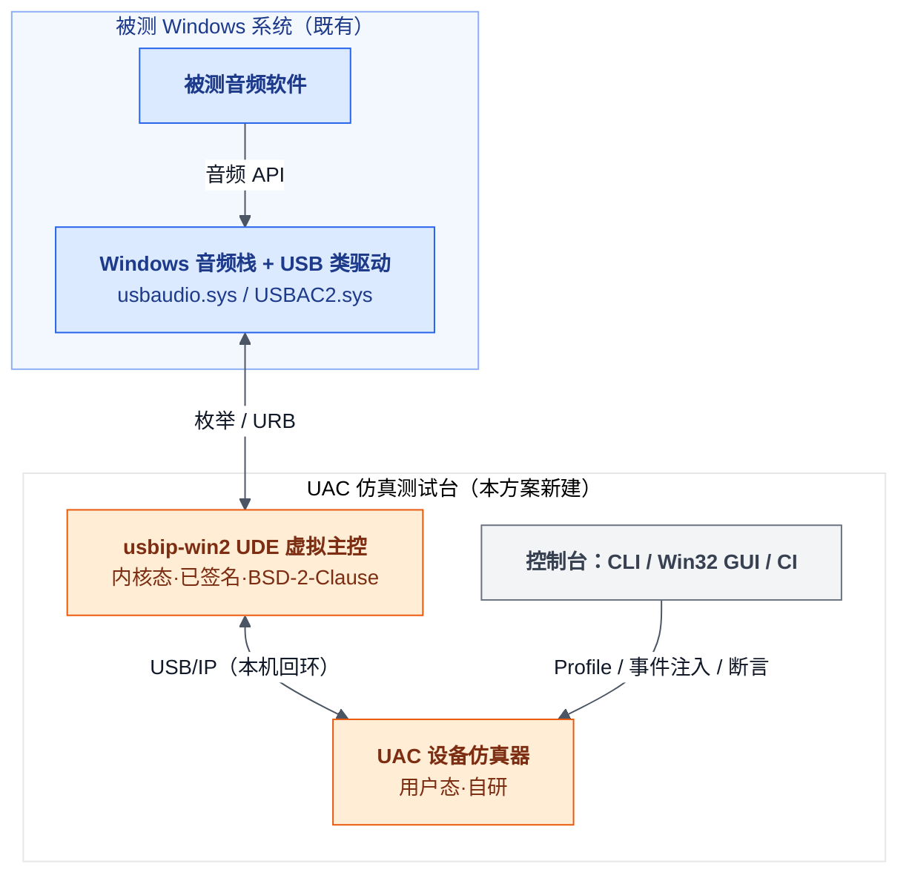
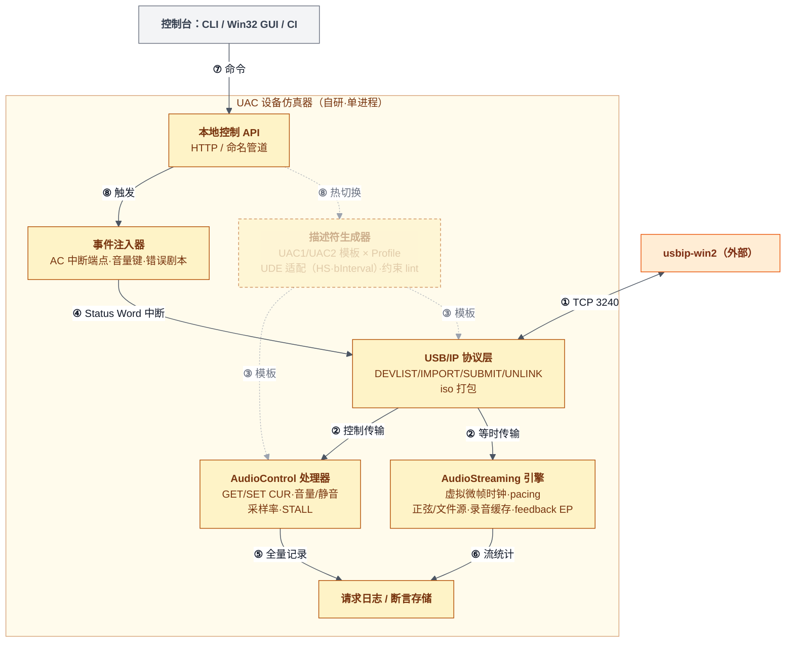
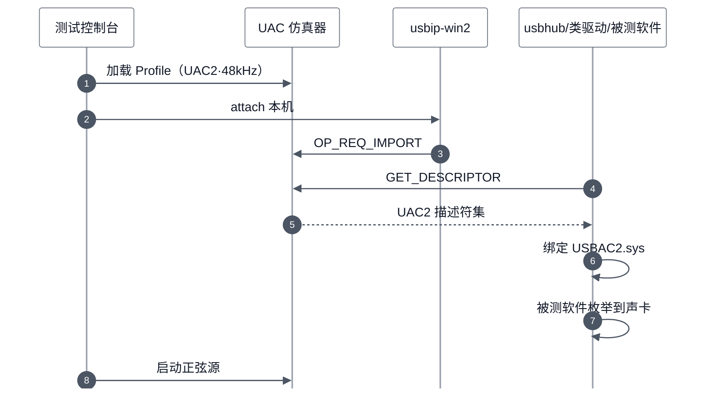
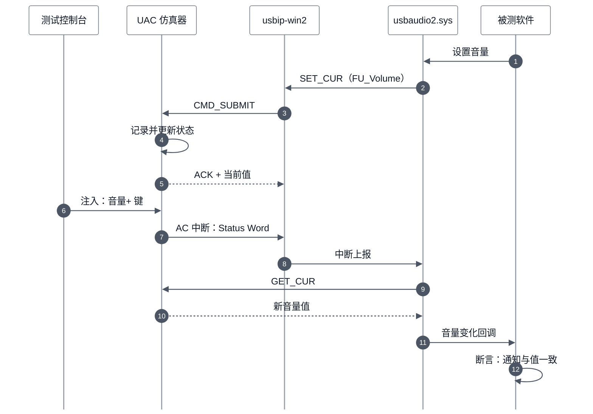

# RFC: Windows 纯软件虚拟 USB 音频设备（UAC 仿真测试台）

> 类型：rfc ｜ 模式：Forward ｜ 状态：Draft v2（2026-10-29 网络核实后修订，依据见 `docs/superpowers/specs/2026-10-29-uac-simulator-design.md`） ｜ 代码基线：`none` ｜ 最后核对：2026-10-29 ｜ 范围：`tools/uac-simulator/`（规划） ｜ lang: zh
>
> **需要你**：评审人（驱动组 + 测试组）在 2026-11-05 前确认 M0 前置验证排期，以及第三方组件 usbip-win2（BSD-2-Clause）的使用边界（仅内部测试，还是允许随包分发）
>
> **勘误（2026-10-30）**：本文早先写作“usbip-win2 为 GPLv3”，有误。核对依据：GitHub 仓库登记的许可为 BSD-2-Clause；`v.0.9.7.8` 与 `v.0.9.8.1` 两个标签上的 `LICENSE.txt` 均为 BSD 2-Clause；源码树中没有 GPL/SPDX 声明。已更正下文四处（顶部“需要你”、Summary、架构图节点标签、R-002），设计文档对应处同步更正。更正不改变架构结论（零代码链接、协议级隔离仍然成立），只放宽了要求：随包分发其二进制时需随附版权声明与许可条款，无源码提供义务。随附数据文件 `usb.ids` 与 CLI11 的许可未逐个核实。

## Summary

本方案在**单台 Windows 上纯软件仿真指定 VID/PID 的 UAC1/UAC2 USB 音频设备**，替代真实声卡/麦克风硬件做主机侧音频软件测试。虚拟 USB 主控复用已签名的开源 [usbip-win2](https://github.com/vadimgrn/usbip-win2)（UDE 框架，零内核开发），设备模型为用户态自研。

评审需决定两件事：等时链路这一最高风险是否按 M0 前置验证；第三方组件 usbip-win2（BSD-2-Clause）是否仅限内部测试使用（若要随包分发，只需随附其版权声明与许可条款）。

**TL;DR**

- 零内核开发：虚拟 USB 主控用现成已签名驱动（usbip-win2，UDE 框架），设备模型全部在用户态，可脚本化。
- 被 Windows 内置类驱动（UAC1: usbaudio.sys / UAC2: usbaudio2.sys）按真设备绑定，被测软件看到的就是"真 USB 声卡"。
- 等时链路风险已从"未证实"降级为"已知解法"：usbip-win2 issue #35（2024-04 修复关闭）确立 UDE 虚拟音频设备三条件——设备呈现 High-Speed、主控实现 QueryBusTime、ISOCH 端点 bInterval≥4。M0 用 Linux f_uac2 探针锁定版本实测，仍为全案 Go/No-Go。
- 音量+/静音等设备侧按键事件通过 UAC 规范的 AC 中断端点 Status Word 通知实现；usbaudio2.sys 官方文档明确支持 Volume/Mute/Connector 的 INTERRUPT 消息。自研用户态模型的核心价值在于 Profile 灵活性、错误注入与脚本化（内核 f_uac2 ≥5.16 已具备中断端点，但拓扑/VID/PID 固定、注入困难）。
- 仿真器须实现虚拟微帧时钟（125µs）对 RET_SUBMIT 做按包延迟（pacing），否则主机侧音频流快进导致欠载——这是架构新增的关键机制。
- 控制台三客户端：CLI（uacsim）+ Win32 原生 GUI（uacstudio）+ CI，共享本地控制 API。

## Motivation

测试主机侧 USB 音频软件（设备枚举、音量控制、静音、采样率切换、设备事件响应）当前依赖真实 USB 声卡与麦克风硬件，存在四个问题：

1. **型号与标识固定**：真实设备 VID/PID、描述符固定，无法模拟目标客户设备或多个机型。
2. **硬件事件难以复现**：设备侧"音量+ / 音量- / 静音"按键依赖人工操作，无法精确回归。
3. **异常场景缺失**：控制请求异常响应、延迟、断连等故障剧本无法用正常硬件构造。
4. **台架成本**：采购、接线、插拔磨损与多台架管理成本随回归规模线性增长。

需求方明确要求：纯软件、Windows 上实现、可指定 VID/PID、支持 UAC1/UAC2、支持音量/静音等标准功能与硬件事件模拟，仅用于测试替代真实设备。

## Goals / Non-Goals

| Goals | Non-Goals |
|---|---|
| R1 纯软件单机：无真实 USB 设备/线缆 | 不做真实物理 USB 设备仿真（如 Facedancer 硬件路线） |
| R2 指定 VID/PID 与字符串描述符 | 不做 UVC 视频设备（架构预留，本期仅音频） |
| R3 音频输入端点（麦克风 IN）+ 输出端点（扬声器 OUT） | 不开发主机侧 USB 驱动：内置类驱动正是被测环境的一部分 |
| R4 UAC1 与 UAC2 双协议档位，被 Windows 内置类驱动（usbaudio.sys / usbaudio2.sys）绑定 | 不追求专业音频指标：测试用途，毫秒级抖动可接受 |
| R5 Feature Unit 标准控制：音量 GET/SET、静音、采样率 | 不支持多设备并发仿真（单设备实例，多实例 M4 扩展） |
| R6 模拟硬件事件：音量键经 AC 中断端点主动通知主机（UAC2 主通道 + HID 回退通道） | 不覆盖 Win10 1903 之前的系统（usbip-win2 下限） |
| R7 可观测可断言：主机控制请求全量日志 + host-probe 主机侧断言 + 错误注入 | 不做跨平台 GUI（Win32 原生，随仿真器同栈交付） |
| R8 可操作：CLI（uacsim）+ Win32 GUI（uacstudio）双控制台，CI 可脚本化 | — |

## Proposed Design

图例：颜色仅标系统边界；实线为主路径（枚举、控制、音频流），虚线为配置类路径。全部组件运行在同一台被测 Windows 机器上（自环形态）。

被测软件经 WASAPI 等音频 API 使用设备；Windows USB 栈把仿真器当成一台插在虚拟主控根集线器上的真设备。仿真器内部结构：

需求到组件的映射：

| 需求 | 承接组件 / 机制 |
|---|---|
| R1 纯软件单机 | UDE 虚拟主控 + 回环 TCP，全程无物理设备 |
| R2 指定 VID/PID | 描述符生成器按 Profile 生成设备/配置/字符串描述符 |
| R3 输入+输出端点 | AudioStreaming 引擎驱动 AS 接口的一对等时端点（IN/OUT） |
| R4 UAC1/UAC2 | 双描述符模板；主机侧分别由 usbaudio.sys（UAC1）与 usbaudio2.sys（Win10 1703+，UAC2）绑定；异步 OUT 按 usbaudio2.sys 约束实现显式 feedback 端点 |
| R5 音量/静音/采样率 | AudioControl 处理器：Feature Unit 的 Volume（1/256 dB）/Mute，UAC1 端点采样率控制与 UAC2 Clock Source |
| R6 硬件事件 | 事件注入器经 AC 中断 IN 端点发送 Status Word（Control Change），usbaudio2.sys 官方支持 Volume/Mute/Connector INTERRUPT 消息；UAC1 档位以 HID Consumer Volume 键回退 |
| R7 观测与注入 | 控制请求全量落日志（NDJSON）；错误剧本可对单条请求返回 STALL、注入延迟、断连、描述符损坏；host-probe（MMDevice/IAudioEndpointVolume/WASAPI+Goertzel）做主机侧断言 |
| R8 双控制台 | 本地控制 API（HTTP JSON/命名管道）之上：CLI 脚本化 + Win32 GUI（Profile/注入/日志面板） |
| —（新）流不快进 | AS 引擎虚拟微帧时钟（125µs）：iso CMD_SUBMIT 按包数 × 微帧延迟 RET_SUBMIT，防主机侧流快进/欠载 |

## Key Flows

### 枚举到类驱动绑定：Windows 把仿真器认成真声卡

主路径为顺序执行的第 1-9 步；任一描述符请求失败即枚举中断（回退见 Rollout）。

### 音量控制与设备侧按键事件：双向验证点

上半段（第 1-5 步）验证主机下发；下半段（第 6-12 步）模拟设备按键并验证主机接收，这是本方案区别于内核 f_uac2 的核心能力。

## Alternatives Considered

| Alternative | Why not chosen |
|---|---|
| Linux VM + 内核 f_uac1/f_uac2 + usbip-win2 客户端 | 保留为 M0 链路探针与降级档：内核 ≥5.16 的 f_uac2 已具备 AC 中断端点（v1 论断过时），降级档可保 R6；但拓扑/VID/PID 受 configfs 约束、错误注入困难、Profile 热切换重、VM 生命周期拖累 CI，不作主方案 |
| 自研 UDE 内核驱动，设备模型内嵌内核 | WDF 内核开发、签名与调试成本高一个数量级；仅当 usbip-win2 等时链路彻底失败时作为升级路径（重新评审） |
| 商业方案（VirtualHere / USB Network Gate / HHD Free Virtual USB Tools） | v1 所引 "USBAnywhere v3.0 WHQL UDE 方案" 经核实查无此产品，已移除；上述真实商业品均为 USB-over-IP 重定向，无可编程设备侧模型与事件注入，仅作参考不作备选 |
| 非总线仿真：PortCls/AVStream 虚拟声卡 | 设备不经 USB 栈枚举，被测软件看到的是非 USB 设备，R4"替代真实 USB 音频设备"即告失败 |

## Risks / Open Issues

| ID | Issue / Risk | Impact | Status | Owner |
|---|---|---|---|---|
| R-001 | 等时链路：v1 判为"未证实"已过时——usbip-win2 [issue #35](https://github.com/vadimgrn/usbip-win2/issues/35)（2024-04 修复）确立解法：设备呈现 High-Speed + QueryBusTime + ISOCH bInterval≥4；残余风险为版本漂移（[#200](https://github.com/vadimgrn/usbip-win2/issues/200) 纪元问题 2026-10 仍开放） | Medium | Mitigated：锁定 usbip-win2 版本 + M0 实测 | 驱动组 |
| R-002 | usbip-win2 许可为 BSD-2-Clause（2026-10-30 勘误，原写 GPLv3）：仿真器仅说 USB/IP TCP 协议、零代码链接；内部测试使用无分发合规问题；随包分发其二进制时需随附版权声明与许可条款，无源码提供义务 | Low | Accepted | 架构 |
| R-003 | 系统版本门槛叠加：UAC2 需 Win10 1703+，usbip-win2 需 Win10 1903+ | Low | Accepted | 驱动组 |
| R-004 | 节奏语义（v1 表述为"1ms 定时精度"，不准）：USB/IP 下主机不等真实总线，仿真器立即回 RET_SUBMIT 会使音频流快进/欠载；须以虚拟微帧时钟按包数延迟应答 | Medium | Mitigated：虚拟微帧时钟 + M1 验收连续 10 分钟播放 | 仿真器组 |
| R-005 | Windows 累积更新导致 usbip-win2 兼容性回归 | Low | Open：锁版本 + M0 脚本可重跑 | 驱动组 |
| R-006 | usbaudio.sys（UAC1）是否处理 AC Status Word 中断未获官方文档背书（usbaudio2.sys 明确支持） | Medium | Open：M2 实测；HID Consumer Volume 键回退保底 | 仿真器组 |
| R-007 | UDE/ucx 黑盒（ucx01000 无源码）排障困难 | Medium | Mitigated：usbip-win2 WPP 跟踪（README 现成脚本）+ issue #35 社区经验 + f_uac2 对照环境 | 驱动组 |

## Rollout & Testing

里程碑与验收标准（M0 为全案 Go/No-Go 点）：

| 阶段 | 内容 | 验收标准 | 出口 |
|---|---|---|---|
| M0（1-2 个专注时段） | 链路探针：Hyper-V Linux VM（内核 ≥5.16）跑 vudc + f_uac2，Windows 侧 usbip-win2 attach；建系统还原点；记录 iso 时序现状（#200 影响）；锁定 usbip-win2 版本 | Windows 出现 f_uac2 声卡，播放/录制正常 | iso 链路判定：Go 进入 M1 |
| M1 | 最小仿真器：USB/IP server 骨架 + UAC1 描述符（UDE 适配：HS 声明 + bInterval 重映射）+ 枚举 + usbaudio.sys 绑定 + 音量 GET/SET + 正弦 IN/OUT 流 + 虚拟微帧时钟 pacing | 设备管理器出现指定 VID/PID 声卡；连续 10 分钟播放无快进/暴音；音量操作全量记录 | R1-R4 达成 |
| M2 | UAC2 模板（显式 feedback 端点 + Clock Source）、采样率切换、AC Status Word 事件注入、UAC1 中断实测、HID 回退通道 | host-probe `volume-watch` 收到事件且值一致；44.1k/48k/96k 切换正确 | R5/R6 达成 |
| M3 | HTTP 控制台 + Profile 热切换（模拟多机型）+ 错误注入全目录 + host-probe 全套 + 最小 Win32 GUI（Device/Inject/Log 面板）+ 自动化回归 | 回归剧本全绿（STALL/延迟/拔线/半枚举）；GUI 可完成注入操作 | R7/R8 达成 |
| M4（收尾） | 多实例（vhci 端口数可配）、GUI 打磨（Stream 面板/电平表）、MS OS 2.0 描述符、多语言字符串、CI 流水线固化 | 多设备并发枚举；CI 全绿 | 全部需求闭环 |

回退路径（失败汇合点）：

- M0 失败 → 评估 usbip-win2 社区修复可行性 / 锁定更早版本重测 → 降级 B 档（Linux VM + f_uac2，可保 R6）→ 升级 C 档（自研 UDE 内核驱动，重新评审）。
- M1-M2 失败但 M0 通过 → 降级为 Linux VM + f_uac2 档位长期运行（R1 的"单机纯 Windows"放宽为"单机含 VM"；R6 经 f_uac2 中断端点仍可保留）。

验证方式：M0-M3 验收即冒烟；M3 起并入版本回归。断言来源为仿真器请求日志（设备侧）与被测软件行为（主机侧）双向比对。

## Review Checklist

- [ ] 图中每条新边都能指到一条需求或一个决策
- [ ] 失败路径汇合到具名回退节点
- [ ] 向后兼容与回滚已说明（全新系统：以回退路径小节代替）
- [ ] 每个 Open Issue 有负责人

## 待确认项

- [x] UDE/UdeCx 对等时端点的官方支持口径（2022 Q&A 帖至今无回复；社区实践解法已确立，见 R-001——官方口径继续跟踪，不再阻塞）
- [ ] usbip-win2 音频等时链路实测结论（M0 产出物；锁定版本号）
- [x] ~~USBAnywhere v3.0 商业备选~~（核实为虚构引用，已从方案移除；真实商业品无设备侧可编程能力，不作备选）
- [x] 被测软件与仿真器同机部署（已确认本机自环；异机仅需改 attach 地址）
- [ ] 首批需要模拟的目标设备 Profile 清单（VID/PID、声道、采样率、音量范围）
- [ ] usbaudio.sys（UAC1）Status Word 中断支持实测结论（M2 产出物；HID 回退已设计）
